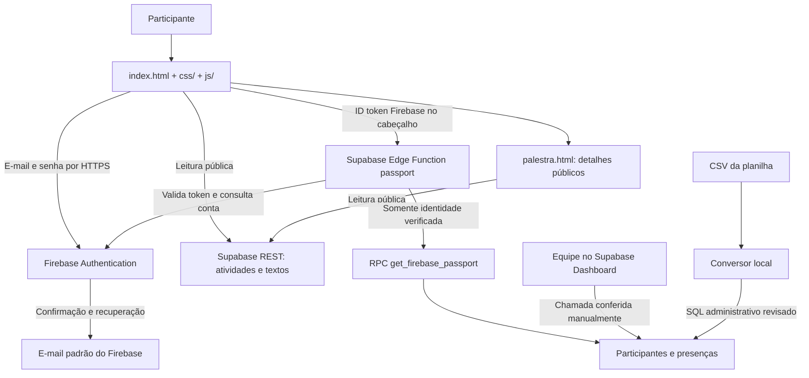

# Passaporte Digital SECCIM

Documentação atualizada em 03/11/2026. Interface e conteúdo em português.

## Estado atual

**Autenticação por e-mail e senha configurada no Firebase Spark; banco, conteúdo e presenças no Supabase Free.** Não é necessário contratar SMTP ou possuir domínio próprio para os e-mails padrão de confirmação e recuperação do Firebase.

| Serviço | Projeto | Estado verificado |
|---|---|---|
| Supabase Free | `passaporte-seccim` / `mqparqbuhstkdpcgbbsa` | Banco, RLS, catálogo e Edge Function ativos; região São Paulo |
| Firebase Spark | `passaporte-seccim-2026` | E-mail/senha habilitado, política de senha aplicada; faturamento desabilitado |
| Frontend | `index.html` (com `css/` e `js/`), `palestra.html` e `patrocinadores.html` | Publicados em https://passaporte-seccim.vercel.app |

[Abrir Supabase](https://supabase.com/dashboard/project/mqparqbuhstkdpcgbbsa) · [Abrir Firebase](https://console.firebase.google.com/project/passaporte-seccim-2026/overview)

O catálogo contém **15 atividades**. O banco já possui presenças reais; não limpar registros nem reaplicar seeds como carga substitutiva. Os testes do editor usam fixtures isoladas em transação revertida.

## Arquitetura



O frontend permanece estático: não há framework, compilação ou dependências de produção para instalar. O `index.html` carrega os estilos de `css/` e os scripts de `js/` (ver [Estrutura do código](#estrutura-do-código)). A fonte visual usa Google Fonts e o ícone é local. As integrações de produção usam as APIs REST oficiais e `fetch`; a Edge Function também não instala bibliotecas externas.

## Página de detalhes das palestras

Cada selo oferece “Saiba mais” e abre `palestra.html?id=<id-da-atividade>`. A página pública mostra o título, categoria, resumo e descrição da palestra, dia/horário, nome/foto/bio do palestrante, redes sociais e slides quando os campos forem preenchidos. O conteúdo remoto é inserido como texto simples. A foto deve estar em HTTPS no domínio `res.cloudinary.com`; redes e slides usam HTTPS.

A migration local `20261105002508_speaker_details.sql` adiciona os campos editoriais a `public.activities`, que já é pública para leitura. O editor está preparado no painel Organização, na seção “Informações das palestras e palestrantes”. Ele permite preencher os campos, ver a foto pelo link HTTPS do Cloudinary e pré-visualizar a página em um iframe. A prévia usa somente `sessionStorage` e não grava no servidor. Não há upload de imagem: o campo aceita o link público de uma imagem já hospedada no Cloudinary, sem credencial no navegador.

A migração local `20261105002514_admin_activity_content.sql` cria a RPC `admin_activity_content`, revisão de conteúdo e auditoria de autoria em tabela **privada**, sem expor o UID do administrador na tabela pública. `GET/POST /functions/v1/passport/admin/activity-content` valida Firebase e a permissão atual em `private.admins`. Apenas campos editoriais permitidos são alterados; revisões antigas recebem 409 para impedir sobrescrita de outro administrador. Horários são enviados em UTC-03 e exibidos em America/Sao_Paulo; a data continua definindo o dia das chances dos sorteios.

As migrações foram aplicadas e a rota implantada na Edge Function `passport` versão 10 após autorização explícita do usuário. O editor agora lê/grava pela API administrativa. Os 51 testes Node do frontend, validação e handler passaram, e `supabase/tests/activity_content.sql` validou a gravação, auditoria, conflitos, bloqueio a conta comum, URLs/datas inválidas e grants em uma transação revertida. O site foi publicado em https://passaporte-seccim.vercel.app; as páginas e os campos editoriais responderam 200, e o endpoint do editor recusou requisições sem identidade válida com 401. A publicação não apaga presenças nem preenche dados fictícios nas palestras reais.

O repositório principal é https://github.com/lipe-s-m/passaporteseccim, configurado como `origin`. `upstream` preserva a referência ao repositório original. Os nomes dos arquivos de migração foram alinhados aos IDs registrados no Supabase para evitar reaplicações. Mudanças futuras em produção continuam dependendo de nova autorização explícita do usuário.

O Firebase guarda e verifica as credenciais. **Não existe coluna de senha no Supabase. A senha não é enviada à Edge Function.** A função recebe somente o ID token, consulta `accounts:lookup` no Google e só então acessa o cadastro correspondente.

A integração foi feita pela Edge Function para permitir usar o Firebase Spark sem Cloud Functions do Firebase ou emissão de custom claims administrativas por usuário. Não é necessário configurar a integração nativa Third-Party Auth no Supabase para esta implementação. O frontend não consulta tabelas privadas diretamente.

## Arquivos

| Arquivo | Responsabilidade |
|---|---|
| `index.html`, `css/`, `js/` | Página principal: HTML, estilos e scripts por área (ver Estrutura do código) |
| `favicon.png` | Ícone original |
| `firebase.json` | Provedor e-mail/senha; login anônimo desabilitado |
| `.firebaserc` | Projeto Firebase deste repositório |
| `supabase/migrations/20261103041651_passaporte.sql` | Estrutura inicial e permissões originais |
| `supabase/migrations/20261103044459_firebase_password_auth.sql` | Transição para Firebase, bloqueio da API privada e RPC do backend |
| `supabase/seed.sql` | 15 atividades e 48 textos atuais |
| `supabase/functions/passport/index.ts` | Entrada da Edge Function e variáveis administrativas do ambiente |
| `supabase/functions/passport/handler.mjs` e `routes/` | Tabela de rotas da API e uma função por rota (ver Estrutura do código) |
| `supabase/functions/passport/firebase-config.mjs` | Projeto e chave Web públicos do Firebase usados no backend |
| `supabase/config.toml` | Configuração da função com autenticação externa no handler |
| `supabase/tests/security.sql` | Testes transacionais dos grants, vínculo e isolamento |
| `supabase/import-mapping.example.json` | Modelo dos cabeçalhos da planilha |
| `scripts/import_csv.py` | Conversão de CSV em SQL administrativo |
| `scripts/check_api.py` | Verificação HTTP de leitura pública e bloqueio privado |
| `scripts/configure_firebase.cjs` | Política de senha e privacidade via sessão administrativa da CLI |
| `scripts/check_auth.cjs` | Teste remoto com contas sintéticas descartáveis |
| `tests/` | Testes locais de frontend, backend e conversor |
| `dados-privados/` | Exportações e manifestos locais, ignorados pelo Git |

As migrações históricas não devem ser reexecutadas no projeto atual. Em um projeto novo, aplicar as duas em ordem e, depois, executar o seed. Os nomes locais estão alinhados ao histórico remoto.

## Estrutura do código

Sem framework e sem compilação: o que está no repositório é o que vai ao ar.

**Página principal.** `index.html` tem só o HTML. Os estilos ficam em `css/` e o JavaScript em `js/`, um arquivo por área. Os scripts são clássicos (não são módulos): carregam na ordem do `index.html`, compartilham o escopo global e cada arquivo pode usar o que os anteriores definiram. Funções chamadas só depois de um clique ou de uma resposta podem estar em qualquer arquivo; o que roda na hora do carregamento (por exemplo `$("x").addEventListener("click", minhaFuncao)`) precisa que `minhaFuncao` já tenha sido carregada. `js/main.js` é o último e inicia a página.

| Arquivo | Área |
|---|---|
| `js/config.js` | URL e chaves **públicas** do Supabase e do Firebase (nunca `service_role`) |
| `js/core.js` | Atalho `$`, estado da sessão, textos, `request`/`fetchJson`, datas, avatar, `loadScript`, `download` e validação de links |
| `js/imagens.js` | Redução de imagens no aparelho e envio para `site-images` |
| `js/auth.js` | Login, cadastro, verificação de e-mail e sessão |
| `js/passaporte.js` | Progresso, selos (agrupados por dia), modal da palestra, link de inscrição, carga do passaporte |
| `js/conquistas.js` | Gamificação: emblema por área, nível e XP, conquistas e aviso de selo novo |
| `js/navegacao.js` | Abas da página |
| `js/faq.js`, `js/ranking.js`, `js/perfil.js`, `js/meu-qr.js`, `js/avaliacoes.js`, `js/pessoas.js` | Telas do participante |
| `js/patrocinadores.js` | Faixa de patrocinadores no rodapé |
| `js/painel.js` | Painel da organização: atividades, busca e atualização |
| `js/painel-palestras.js`, `js/painel-presencas.js`, `js/painel-sorteio.js`, `js/painel-patrocinadores.js`, `js/painel-moderacao.js`, `js/painel-avaliacoes.js`, `js/painel-leitor-qr.js` | Seções do painel |
| `js/main.js` | Atalhos de teclado e inicialização |
| `css/*.css` | `base`, `passaporte`, `selos`, `componentes`, `responsivo`, `ranking`, `perfil`, `qr`, `painel`, `sorteio`, `rodape`, `avaliacoes`, `pessoas`, `animacoes`, nessa ordem |

Arquivo novo em `js/` ou `css/` precisa entrar no `index.html`; o teste `tests/frontend.test.cjs` falha se algum ficar de fora. `palestra.html` e `patrocinadores.html` continuam autocontidas.

**Edge Function `passport`.**

| Arquivo | Papel |
|---|---|
| `index.ts` | Entrada no Deno, lê as variáveis do ambiente |
| `handler.mjs` | Tabela de rotas (final do caminho → métodos aceitos → função); confere método e identidade e repassa |
| `auth.mjs` | Verificação do token Firebase no Google (`accounts:lookup`) |
| `services.mjs` | RPCs e Storage com a chave administrativa, sempre com o UID verificado (`adminRpc`, `passportRpc`, `profileRpc`, `signPhotos`…) |
| `http.mjs` | Resposta JSON com CORS, `validDate`, `readJson` |
| `routes/passaporte.mjs` | Passaporte (rota padrão), ranking e QR pessoal |
| `routes/faq.mjs`, `routes/perfil.mjs`, `routes/moderacao.mjs` | FAQ, perfil e foto, moderação |
| `routes/presencas.mjs` | Presenças por palestra, em lote, cadastro na hora, várias palestras e leitor de QR |
| `routes/sorteio.mjs` | Exportação do sorteio e sorteio no painel |
| `routes/conteudo.mjs` | Editor das palestras, patrocinadores e envio de imagens do site |
| `routes/avaliacoes.mjs` | Pesquisa de satisfação (participante e resultado para a organização) |
| `routes/pessoas.mjs` | Busca de participantes e perfil com selos e brindes |
| `*-content.mjs`, `qr-token.mjs`, `site-images.mjs` | Validações compartilhadas com os testes |

Para criar uma rota: escrever a função em `routes/` (recebe `{ request, url, user, ... }` e devolve `response(...)`) e acrescentar uma linha na tabela de `handler.mjs`. A identidade já chega verificada; a permissão de organização é sempre conferida no banco pela RPC.

## Modelo de dados e administração

| Tabela | Campos principais | Acesso do navegador |
|---|---|---|
| `site_content` | `key`, `value` | Leitura pública |
| `activities` | `id`, `name`, `description`, `category`, `sort_order`, `active` | Leitura das atividades ativas |
| `participants` | `id`, `firebase_uid`, `full_name`, `email`, `legacy_id`, `created_at` | Sem acesso direto |
| `attendances` | `participant_id`, `activity_id`, `recorded_at` | Sem acesso direto |

`participants.id` é um UUID estável. `firebase_uid` é o identificador textual único da conta Firebase; não pode ser convertido para `auth.uid()`, que espera UUIDs do Supabase Auth. `auth_user_id` foi mantido apenas como campo legado; o trigger antigo do Supabase Auth foi removido. Links `?id=`/`?ID=` não autorizam acesso.

O e-mail fica normalizado em minúsculas e é único. A primeira consulta de uma conta com e-mail confirmado cria o cadastro ou vincula o registro importado com aquele e-mail, preservando nome e presenças existentes. Um cadastro já vinculado a outro UID não pode ser reivindicado. O vínculo é estável pelo UID; mudanças posteriores de e-mail/nome no Firebase não sobrescrevem silenciosamente o cadastro administrativo.

Para conceder um selo, a equipe confere a chamada, localiza a pessoa em `participants` e cria uma linha em `attendances` com seu UUID e o `activity_id`. A chave composta impede duplicação. Corrigir uma presença exige remover somente a linha correspondente pelo Dashboard. Participantes não têm função de registrar presença.

Editar textos em `site_content` e descrições/ordem em `activities`. `active=false` retira a atividade do catálogo e do denominador do progresso, preservando o histórico. Não excluir atividades com presenças; a chave estrangeira restringe essa operação.

## Fluxo do participante

1. A página carrega os textos e o catálogo em memória. Antes do login, exibe apenas a área de acesso: resumo do participante, progresso e coleção ficam ocultos, inclusive no HTML inicial. O formulário tem uma única ação principal e um link para alternar entre entrada e cadastro.
2. No primeiro acesso, a pessoa escolhe **Criar conta**, informa nome, o mesmo e-mail da inscrição e senha com pelo menos 8 caracteres, incluindo uma letra e um número (máximo de 128).
3. O Firebase cria a conta. A aplicação solicita um e-mail de confirmação usando o remetente padrão do Firebase.
4. A pessoa confirma pelo link, volta ao passaporte e usa **Já confirmei meu e-mail**. O backend consulta o estado atual da conta no Google.
5. Em acessos seguintes, entra com e-mail e senha. Não é enviado código a cada login.
6. **Esqueci minha senha** usa o e-mail e o formulário de recuperação gerenciados pelo Firebase.
7. A sessão fica na memória e em `sessionStorage` da mesma aba para permitir voltar da página de palestra e recarregar sem entrar novamente. Nenhuma senha é armazenada. O token continua sendo validado pelo backend a cada consulta e renovado pelo Firebase quando necessário; tokens rejeitados são descartados. A opção Sair também remove a sessão salva.
8. **Sair** limpa os tokens e os dados privados deste navegador. É um logout local, equivalente ao descarte da sessão no cliente; não revoga todas as sessões da conta.

O autocadastro cria um passaporte vazio, sem conceder presenças. O nome fornecido pelo usuário é apenas texto de apresentação, nunca uma autorização administrativa.

## Segurança

- Firebase Authentication guarda/verifica as senhas. O aplicativo não implementa criptografia própria, não armazena senha e não a envia ao banco de presenças.
- Política aplicada e conferida no Firebase: `ENFORCE`, mínimo 8, máximo 128 caracteres e pelo menos um número. O formulário também exige pelo menos uma letra, maiúscula ou minúscula. A política nativa do Firebase permite exigir minúscula ou maiúscula separadamente, mas não oferece a condição alternativa “qualquer uma das duas”; a exigência de letra sem restringir a caixa é validada no formulário. A proteção contra enumeração de e-mails também está ativa no servidor.
- A confirmação do e-mail é exigida pelo backend, não apenas pela interface. Contas desabilitadas, inexistentes ou com token anterior à revogação (`validSince`) são recusadas.
- O handler exige token Bearer, confere algoritmo, projeto (`aud`), emissor (`iss`), sujeito e validade, e pede ao endpoint oficial do Google a verificação do token e a conta correspondente. **Decodificar JWT não é suficiente**: o banco só é acessado após sucesso dessa consulta autenticada ao Google.
- UID, nome e e-mail usados na RPC vêm exclusivamente da conta retornada pelo Google. IDs, e-mails, corpos ou claims de papel enviados pelo cliente não escolhem outro cadastro.
- As quatro tabelas têm RLS. `anon` e `authenticated` não têm grants ou policies de acesso a participantes/presenças, nem permissões de escrita nas tabelas da aplicação.
- A RPC é `SECURITY INVOKER`, com `search_path` vazio e execução permitida apenas a `service_role`. O papel administrativo é usado exclusivamente no ambiente confiável da Edge Function. Ele ignora RLS; por isso a validação prévia da identidade no handler e o escopo da RPC são essenciais.
- `verify_jwt=false` na função significa que a checagem de JWT Supabase do gateway foi substituída pela autenticação Firebase no handler. Não significa acesso anônimo aos dados. A função responde 401 sem token válido e 403 sem e-mail confirmado.
- CORS permite chamar o endpoint de uma hospedagem estática. CORS não é usado como autorização; toda requisição depende da conta verificada.
- Respostas privadas não entram em cache e contêm apenas UUID, nome e IDs dos selos. E-mails, respostas internas, hashes e chaves administrativas não são retornados.
- Tokens e senhas não são persistidos em `localStorage`, cookies ou URLs. A chave Web Firebase e a publishable Supabase são públicas; segredos administrativos ficam fora do frontend/Git.
- Conteúdo remoto entra na tela com `textContent`. Somente ícones SVG locais usam `innerHTML`.
- Requisições têm limites de tempo. Respostas de uma sessão encerrada não restauram dados na tela. Recuperação e erros de login usam mensagens controladas para reduzir exposição de existência de contas.

A chave administrativa padrão `SUPABASE_SERVICE_ROLE_KEY` é fornecida automaticamente ao runtime da função. Não copiá-la para arquivos ou para o frontend. Não é necessária chave de conta de serviço Google: o backend verifica o ID token como usuário no endpoint oficial do Firebase.

A exclusão de uma conta Firebase não apaga automaticamente o cadastro administrativo no Supabase. O backend passa a recusar a conta removida. Para excluir os dados pessoais e presenças, a equipe também deve excluir a linha correspondente em `participants`; suas presenças são removidas por cascata. Recriar uma conta com outro UID exige revisão administrativa do vínculo anterior.

## Configuração e execução

As configurações públicas já estão preenchidas:

- `SUPABASE_URL` e `SUPABASE_PUBLISHABLE_KEY` no HTML.
- `FIREBASE_PROJECT_ID` e `FIREBASE_API_KEY` no HTML.
- Os mesmos valores Firebase em `supabase/functions/passport/firebase-config.mjs`.

Para desenvolver localmente:

```powershell
python scripts/serve.py --host 127.0.0.1 --port 8000
```

Abrir `http://127.0.0.1:8000`. O servidor é apenas de desenvolvimento. Para publicar, servir somente o que o `.vercelignore` libera (páginas, `css/`, `js/`, `vendor/`, `fotos/` e `favicon.png`) por HTTPS; nunca disponibilizar `dados-privados/` ou scripts administrativos. Nenhuma hospedagem estática foi publicada nesta tarefa.

O projeto Firebase usa o domínio padrão `passaporte-seccim-2026.firebaseapp.com` para confirmação e redefinição de senha. O frontend pede mensagens em pt-BR. O idioma, a aparência e a entrega efetiva dos e-mails devem ser conferidos com uma conta real da equipe. Não há SMTP externo configurado.

O provedor foi habilitado com a CLI oficial, usando sessão autorizada pelo usuário:

```powershell
npx.cmd -y firebase-tools@latest login
npx.cmd -y firebase-tools@latest deploy --only auth --project passaporte-seccim-2026
```

Os utilitários administrativos `configure_firebase.cjs` e `check_auth.cjs` usam módulos da CLI já instalada, sem exibir credenciais. Foram verificados com `firebase-tools 15.34.2`. Recebem como argumento o diretório desse pacote; uma atualização da CLI pode exigir revisar os imports internos. Esses utilitários não fazem parte do site publicado.

## Importar a planilha

O Forms e a planilha antigos não são sincronizados automaticamente. Para importar:

1. Exportar CSV UTF-8 com nome, e-mail e as colunas dos 15 selos para `dados-privados/respostas.csv`.
2. Copiar `supabase/import-mapping.example.json` para `dados-privados/mapeamento.json`, ajustando os cabeçalhos reais. Remover `identificador` se não houver coluna de ID.
3. Executar:

   ```powershell
   python scripts/import_csv.py dados-privados/respostas.csv --mapping dados-privados/mapeamento.json
   ```

4. Revisar `dados-privados/importacao.sql` e aplicá-lo no SQL Editor administrativo do Supabase.
5. Conferir amostras e quantidades. Orientar participantes a usar no Firebase o mesmo e-mail informado no Forms.

O conversor exige mapear cada atividade uma vez e recusa dados duplicados ou inválidos. Valores positivos: `1`, `true`, `sim`, `s`, `x`, `presente`, `confirmado`, `conquistado`, `✓`, `✔`. Negativos: vazio, `0`, `false`, `não`/`nao`, `n`, `ausente`, `pendente`, `bloqueado`. Datas e valores desconhecidos exigem revisão.

A carga é transacional e aditiva: atualiza nome/ID antigo pelo e-mail e acrescenta presenças sem apagar as existentes. Não cria contas Firebase, não atribui privilégios e não importa senhas. O primeiro acesso verificado vincula o histórico. O mapeamento é um exemplo: os cabeçalhos reais ainda não foram fornecidos. Após falha de conversão, não reutilizar SQL de uma execução anterior.

## Validação realizada

Testes locais, sem instalar dependências da aplicação:

```powershell
node --test tests/frontend.test.cjs tests/passport.test.mjs
python -m unittest discover -s tests -p 'test_*.py'
```

**25 testes locais passaram:** 10 do frontend, 9 do handler e 6 do conversor. Cobrem cadastro/login/recuperação, exigência de confirmação, destino da senha, renovação, logout com respostas atrasadas, catálogo e modal, tokens malformados/adulterados/de outro projeto, contas desabilitadas/revogadas e importação da planilha.

Também executados no ambiente real:

- `supabase/tests/security.sql`: vínculo preservando o nome importado, bloqueio de reivindicação de outra identidade, isolamento das presenças, grants/RLS e RPC administrativa inacessível a clientes. Fixtures revertidas por transação.
- `python scripts/check_api.py`: 15 atividades e 48 textos acessíveis; participantes e presenças retornam HTTP 401 sem login.
- `scripts/check_auth.cjs`: senha curta rejeitada no servidor; duas contas sintéticas sem confirmação bloqueadas; tokens adulterados recusados; contas marcadas como confirmadas pela API administrativa consultaram seus próprios passaportes; leitura REST privada com token Firebase recusada. Não enviou e-mails. Contas Firebase apagadas e cadastros Supabase removidos ao final.
- Consulta de faturamento Google confirmou `billingEnabled=false` no novo projeto.

A auditoria Supabase não retornou avisos de nível WARN ou ERROR. Há informações esperadas de **RLS sem policies nas duas tabelas privadas**, pois o modelo é bloquear totalmente clientes e usar o backend, e de índice de atividade ainda sem uso em um banco sem presenças reais. Referências: [RLS sem policies](https://supabase.com/docs/guides/database/database-linter?lint=0008_rls_enabled_no_policy) e [índice sem uso](https://supabase.com/docs/guides/database/database-linter?lint=0005_unused_index).

**Pendente de validação manual:** recebimento do e-mail real, confirmação pelo link, recuperação de senha e inspeção visual do site no navegador. Os testes remotos marcaram os e-mails sintéticos como confirmados administrativamente; isso testa o bloqueio e a consulta, mas não comprova entrega de mensagens. Também faltam a planilha real e a publicação do frontend.

## Limites relevantes

O Firebase Spark documenta 1.000 confirmações de endereço e 150 recuperações de senha por dia; o login com senha não envia e-mail a cada entrada. A criação de contas tem limite de 100 novas contas por hora por IP, relevante se muitos participantes se cadastrarem pela mesma rede do evento. [Limites oficiais](https://firebase.google.com/docs/auth/limits).

O Supabase Free pode pausar projetos por baixa atividade durante sete dias. Verificar a disponibilidade antes do evento. [Política de pausa](https://supabase.com/docs/guides/platform/free-project-pausing).

Referências técnicas: [Firebase REST Auth](https://firebase.google.com/docs/reference/rest/auth), [accounts.lookup](https://docs.cloud.google.com/identity-platform/docs/reference/rest/v1/accounts/lookup), [proteção da Data API](https://supabase.com/docs/guides/api/securing-your-api) e [autenticação de Edge Functions](https://supabase.com/docs/guides/functions/auth).

## Histórico de alterações

### 03/11/2026 — Análise do original

- Clonado `BiahMoree/meupassaporteseccim`, inicialmente com HTML único e favicon.
- Identificados cartões sem títulos, indicador ONLINE fixo e falhas de carregamento.
- Mapeada a consulta original ao Apps Script por `?id=` e a operação manual na planilha.

### 03/11/2026 — Migração inicial para Supabase

- Criadas tabelas de textos, atividades, participantes e presenças, com RLS e grants explícitos.
- Projeto Free criado em São Paulo; aplicados schema e carga dos 15 selos e 42 textos iniciais.
- Corrigidos cartões, estados de progresso, erros e navegação de teclado no modal.
- Acrescentados conversor CSV, testes, documentação e proteção contra versionar dados privados.
- Primeiro fluxo usava OTP do Supabase; envio público ficou pendente de SMTP.

### 03/11/2026 — Firebase com e-mail e senha

- Substituído o OTP por cadastro, login e recuperação de senha no Firebase Spark, mantendo o Supabase como banco.
- Criado projeto Firebase separado e aplicativo Web; habilitado provedor e-mail/senha sem faturamento.
- Configuradas política de senha e proteção contra enumeração.
- Publicada função `passport`, que valida identidade e confirmação no Google antes da RPC.
- Criado vínculo `firebase_uid`; removidos o trigger antigo e as permissões de leitura direta de tabelas privadas.
- Atualizados os textos remotos e o seed para 48 registros; removidas as mensagens OTP do fluxo atual.
- Adicionados testes do backend e teste remoto com limpeza das contas temporárias.
- Nenhuma senha, conta de serviço ou chave administrativa adicionada ao repositório.

### 03/11/2026 — Separação das telas de acesso e passaporte

- Removida a barra com ações Entrar/Criar conta duplicadas em relação ao envio do formulário.
- Cada formulário agora mostra uma ação principal e apenas o link para o outro modo; recuperação de senha aparece somente na entrada.
- Participante, progresso e coleção só aparecem após consulta autenticada com e-mail confirmado. Sair ou perder a sessão oculta essas áreas e remove os cartões da tela.
- Mensagens de erro e tentativa de recarregar ficam fora das áreas ocultas para continuarem acessíveis antes do login.
- Os 12 testes de frontend passaram, incluindo os estados antes do login, após confirmação, a navegação do FAQ e o logout com resposta atrasada.

## FAQ das palestras — 03/11/2026

A navegação inclui Meu passaporte e FAQ · Perguntas. Após entrar com e-mail confirmado, o participante escolhe uma atividade, consulta perguntas e publica a sua (até 2.000 caracteres). Pode editar o texto, alternar o anonimato e excluir somente suas próprias perguntas, com confirmação antes da exclusão. Há atualização manual e paginação de 50 perguntas.

O anonimato oculta o nome dos demais participantes, inclusive na resposta da API. A organização mantém a autoria no banco. Para preservar edição/exclusão entre acessos, perguntas anônimas também exigem login. A participação não depende de o selo de presença já ter sido importado pela organização.

A tabela questions tem RLS e nenhum grant para clientes. A função manage_faq usa security invoker e é executável somente por service_role. A Edge Function passport/questions verifica a conta no Firebase e deriva o UID no servidor; alterações no banco sempre filtram autor, pergunta e atividade. Nenhum UID, e-mail ou ID de participante é enviado nas respostas de perguntas. O login e as presenças mantêm o comportamento anterior.

Migração 20261103045648_lecture_faq aplicada ao Supabase e Edge Function passport atualizada para a versão 2. Os testes SQL em supabase/tests/faq.sql passaram no banco real com rollback dos dados temporários: criação, anonimato, edição/exclusão pelo autor, bloqueio de outra pessoa, validação e grants. Os 22 testes Node passaram. A auditoria retornou apenas informações de RLS sem policies nas três tabelas privadas, intencional neste modelo de backend exclusivo: https://supabase.com/docs/guides/database/database-linter?lint=0008_rls_enabled_no_policy . Inspeção visual e login completo no navegador não executados nesta etapa. O HTML atualizado precisa ser servido pela hospedagem usada pela equipe; nenhuma hospedagem de frontend foi publicada nesta alteração.


### 03/11/2026 — Texto e apresentação do acesso, mobile first

- Removido da interface o parágrafo técnico sobre Firebase, Supabase, transmissão de senha e recarregamento de sessão. Detalhes de arquitetura ficam nesta documentação.
- Aplicadas as orientações da skill [frontend-design](https://github.com/anthropics/skills/blob/main/skills/frontend-design/SKILL.md), consultada no repositório oficial por não estar instalada localmente: texto pela perspectiva do participante, hierarquia de ações, contenção visual e respeito à identidade existente.
- Direção visual: preservar fundo azul-escuro, roxo e verde da SECCIM e tipografia pixelada de apresentação; manter o formulário legível e sem novas ornamentações.
- O formulário parte de uma coluna no celular, campos e ação principal com 48 px de altura e fonte de entrada de 16 px. Ações secundárias têm hierarquia de link e foco de teclado visível.
- Em telas maiores, o cartão mantém largura máxima de 460 px; o ajuste de espaçamento usa breakpoint de largura mínima, sem depender de correções de desktop para o formulário móvel.
- O conteúdo autenticado continua oculto antes da confirmação de acesso. A alteração não modifica autenticação ou permissões.


### 03/11/2026 — Regra de senha solicitada

- Cadastro ajustado para no mínimo 8 caracteres, com pelo menos uma letra e um número, permitindo maiúsculas, minúsculas e símbolos opcionais.
- Política do Firebase atualizada e conferida para mínimo 8 e presença de número; nenhuma obrigação adicional de maiúscula, minúscula ou símbolo foi introduzida.
- A verificação de letra fica no formulário devido à limitação da política nativa descrita na seção de segurança. Uma chamada direta à API Firebase pode cadastrar uma senha somente numérica; não se deve afirmar que a exigência de letra é aplicada no servidor.


### 03/11/2026 — Correção do envio de confirmação após cadastro

- Reproduzido com conta sintética real: `accounts:update` ao alterar apenas o nome pode responder HTTP 200 sem `idToken`, `refreshToken` ou `expiresIn`.
- O frontend tentava salvar essa resposta como sessão completa e abortava antes de chamar o envio da confirmação. A mensagem atribuía incorretamente a falha ao envio do e-mail.
- Mantida a sessão original do cadastro quando a atualização do nome não renova tokens; uma nova sessão só substitui a anterior quando a resposta contém os campos necessários.
- Separadas as mensagens de falha de atualização do nome e de envio de confirmação.
- O teste de cadastro agora simula a resposta real sem tokens e verifica que o pedido de confirmação usa o token preservado.
- A conta sintética de diagnóstico foi removida; nenhum e-mail foi enviado durante esse diagnóstico. O recebimento real continua a ser conferido pelo participante ao reenviar a confirmação.


### 03/11/2026 — Identificação e acesso pela rede local

- Removida da interface a identificação UUID, que é uma chave interna do cadastro no banco. O identificador continua existindo apenas para os vínculos internos.
- Adicionado `scripts/serve.py`, com publicação restrita a HTML e favicon e sem listagem de diretórios.
- Servidor de teste alterado de loopback para `0.0.0.0:8000`, por solicitação do usuário, permitindo teste na mesma rede pelo IP do computador.
- Verificados HTTP 200 no endereço da rede e HTTP 404 para `.git`, diretório de dados privados e documentação. Os 12 testes de frontend passaram.


### 03/11/2026 — Revisão de tipografia e alinhamento

- Corrigidas regras antigas que reduziam a tipografia no celular. Corpo e controles principais usam 16 px, títulos de apresentação variam entre 28 e 40 px e o título do acesso usa 26 px.
- Centralizados o bloco de apresentação, os títulos e a descrição de acesso, o cartão, os botões e a navegação. Rótulos dos campos permanecem à esquerda para facilitar a leitura.
- Aumentados os textos de selos, progresso, categorias, modal e FAQ; ações principais mantêm alvos de toque entre 48 e 52 px.
- Removidos os breakpoints antigos de largura máxima. A grade parte de uma coluna e ganha colunas por breakpoints de largura mínima.
- Os 12 testes de frontend passaram. A inspeção visual via Computer Use não foi concluída: a captura da janela do Chrome retornou timeout em duas tentativas. Não afirmar que o layout foi conferido visualmente no navegador.


### 03/11/2026 — Acesso pelo celular e Firewall

- Conferidos listener `0.0.0.0:8000`, IP local `192.168.0.135/24` e resposta HTTP 200 pelo endereço da rede no computador.
- A conexão Ethernet está classificada como pública; a leitura das regras do Firewall pela sessão normal foi negada pelo Windows.
- Aplicada com elevação do Windows (retorno 0) a regra de entrada `SECCIM.Passaporte.LAN.8000`, permitindo TCP 8000 somente para o executável `C:\Python313\python.exe`, endereço local `192.168.0.135` e origem `192.168.0.0/24`. O Firewall permanece habilitado.
- Solicitada confirmação do acesso a `http://192.168.0.135:8000` pelo celular na mesma rede. O teste de conexão feito no computador, isoladamente, não comprova a comunicação do celular com o servidor.
# Publicação na Vercel — 03/11/2026

Atualização posterior: sistema de chances para brindes implementado e implantado na Edge Function `passport` (versão 4). A migração `20261103055811_daily_raffle.sql` adiciona o dia e elegibilidade de cada atividade, a tabela de chances por presença, sincronização transacional e uma lista privada de contas administrativas. O GET `/passport/admin/raffle?date=AAAA-MM-DD` exige identidade Firebase confirmada e autorização consultada no banco. Não há interface de sorteios nem escolha automática de vencedor. Operação, API, exportação e segurança estão descritas em [SORTEIOS.md](SORTEIOS.md). Datas oficiais e conta administrativa real dependem da indicação da organização; nenhuma data foi inventada e nenhuma conta comum foi promovida.

Site público: https://passaporte-seccim.vercel.app. Projeto Vercel `passaporte-seccim`, na conta conectada. Deploy de produção realizado pela CLI Vercel 65.10.0. O domínio foi incluído nos domínios autorizados do Firebase, preservando os anteriores. Firebase e Supabase continuam responsáveis por autenticação e dados.

`vercel.json` configura hospedagem estática, revalidação da página e cabeçalhos de segurança. `.vercelignore` é uma lista de permissão: só as páginas, `css/`, `js/`, `vendor/`, `fotos/`, `favicon.png` e `vercel.json` são enviados. Documentação, migrações, scripts e dados privados não são publicados. `.vercel/` mantém o vínculo local do projeto e é ignorado pelo Git.

**Publicação automática:** o projeto Vercel está conectado ao repositório GitHub `lipe-s-m/passaporteseccim`. Cada push no `main` publica o site em produção em poucos segundos; o `.vercelignore` continua limitando o envio aos arquivos do site. Pushes em outras branches geram previews protegidos por login da Vercel. O deploy manual pela CLI (`npx -y vercel@65.10.0 deploy --yes --prod`) continua possível.

**Ordem ao mudar backend e site juntos:** migrações e Edge Function não são publicadas pelo push. Primeiro `npx -y supabase db push --remote --yes`, depois `npx -y supabase functions deploy passport --remote --yes`, e só então o push do site, para o site novo nunca chamar rotas que ainda não existem. O helper `scripts/authorize_firebase_domain.cjs` permite autorizar novos domínios usando a sessão administrativa local da CLI Firebase, sem expor credenciais.

Validação: domínio público respondeu HTTP 200 sem autenticação Vercel e contém ranking e link de inscrição. URLs de `dados-privados`, `.git/config`, documentação e código da Edge Function responderam HTTP 404.

# Ranking de selos e inscrições — 03/11/2026

A aba Ranking fica disponível após o login com e-mail confirmado. Mostra os 20 participantes com mais selos de atividades ativas, em ordem decrescente, e destaca a própria conta. O resumo mostra a posição do participante mesmo fora dos 20 primeiros. Participantes sem selos ainda não recebem posição. Empates usam `dense_rank()`: quem empata divide a posição e o próximo vem logo em seguida, sem pular (exemplo: 1, 2, 2, 2, 3; migração `20261108120000_dense_ranking.sql`). Nomes e IDs internos servem somente para estabilizar a ordem de exibição, sem desempatar a pontuação.

O frontend consulta `GET /functions/v1/passport/ranking` com o token Firebase. A Edge Function valida a conta no Google antes de chamar `get_badge_ranking(p_uid)`, disponível exclusivamente para `service_role`, com `SECURITY INVOKER` e `search_path` vazio. A resposta contém nome, posição, quantidade de selos e indicação da própria conta. E-mails, UUIDs e UIDs não fazem parte da resposta do ranking. As tabelas privadas continuam sem acesso direto pelo navegador; o ranking é somente leitura e não concede presenças. A lista e os pedidos pendentes são invalidados ao sair da conta.

Cada selo abre um modal com “Link para inscrição”, apontando para o Google Forms fornecido pela organização. O link abre em outra aba com `noopener noreferrer`. A navegação de foco do modal inclui fechar e inscrição. Inscrever-se pelo formulário não concede selo: a organização continua registrando as presenças.

Migração aplicada: `20261103053433_badge_ranking.sql`. Testes: `node --test tests/frontend.test.cjs tests/passport.test.mjs` (25 testes), mais `supabase/tests/ranking.sql` para empates, atividades inativas, participante sem selos, identidade inexistente e permissões da RPC. Os testes SQL usam uma transação revertida e preservam os dados reais.


# Painel da organização — 03/11/2026

Contas listadas em `private.admins` veem a aba **Organização** depois do login. As demais contas não veem a aba: o frontend pede a visão geral ao backend e só mostra o painel quando recebe 200.

**Registro de presenças:** escolher a atividade em andamento, buscar a pessoa pelo nome ou e-mail (mínimo de 2 letras, até 20 resultados) e tocar em **Registrar presença**. A busca é limpa e volta o foco para o campo, para registrar a próxima pessoa. A lista **Presentes nesta atividade** mostra os registros mais recentes (até 1.000) e permite remover uma presença, com confirmação. Repetir um registro não duplica selo nem chance. Só aparece quem já criou a conta no passaporte; quem ainda não criou precisa se cadastrar antes.

**Sorteio do dia:** baixa TXT e JSON do dia escolhido pelo endpoint `GET /passport/admin/raffle`. Recusa a geração se houver presenças em atividades sem data ou se os totais mudarem durante a paginação.

**Backend:** rota `GET|POST|DELETE /functions/v1/passport/admin/attendance`. O GET aceita `action=overview|search|list`; o POST registra e o DELETE remove (corpo `{activity, participant}`). A Edge Function valida o token no Google e passa somente o UID verificado à RPC `admin_attendance`. A RPC é `SECURITY DEFINER` com `search_path` vazio e EXECUTE somente para `service_role`, e consulta `private.admins` em cada chamada, de modo que a revogação vale na requisição seguinte. Presenças registradas pelo painel guardam o UID do organizador em `attendances.recorded_by`. As respostas do painel incluem o e-mail dos participantes, porque a organização precisa distinguir homônimos; nunca incluem UIDs Firebase.

**Conceder acesso:** a conta precisa ter se cadastrado no passaporte, confirmado o e-mail e entrado uma vez. Depois, no SQL Editor, executar o `insert into private.admins ...` descrito em `SORTEIOS.md`. Não registrar e-mails ou UIDs administrativos neste repositório, que é público.

Testes: `node --test tests/frontend.test.cjs tests/passport.test.mjs` (34 testes) e `supabase/tests/admin_attendance.sql` (busca literal com `%`, registro idempotente, autor do registro, sincronização com o sorteio, lista, visão geral sem atividades inativas, remoção, validações, participante comum bloqueado, revogação imediata e permissões). Todas as migrações e os 5 testes SQL foram executados em um Postgres 17 local com papéis equivalentes aos do Supabase.

## Cadastro na hora, sorteio no painel e redes sociais — 03/11/2026

**Cadastro na hora:** quando a busca não encontra a pessoa, o organizador usa **Cadastrar participante na hora** (o texto digitado na busca já preenche nome ou e-mail). O backend cria o cadastro sem conta Firebase e registra a presença. Quando a pessoa criar a conta no passaporte com o mesmo e-mail, `get_firebase_passport` vincula o cadastro e o selo aparece. Se o e-mail já tiver cadastro, nada é sobrescrito: apenas a presença é registrada. Rota `POST /passport/admin/participants` → RPC `admin_register_participant` (`SECURITY DEFINER`, autorização em `private.admins`).

**Sorteio no painel:** o card **Sorteio do dia** escolhe o ganhador no banco, e não no navegador. A RPC `admin_raffle_draw` ordena as chances do dia por `gen_random_uuid()` (gerador criptográfico), o que dá probabilidade proporcional ao número de presenças da pessoa no dia. O resultado é gravado em `public.raffle_draws`, com no máximo uma vitória por pessoa e por dia, e um bloqueio por dia serializa sorteios simultâneos de organizadores diferentes. O navegador apenas anima a roleta com nomes do dia e solta confete; com "reduzir movimento" ativado no sistema, mostra o resultado direto. **Ausente** marca o ganhador e permite sortear de novo; a pessoa ausente não volta a concorrer naquele dia. **Apagar** remove o registro de vez (sorteios de teste ou feitos por engano): a pessoa volta a concorrer no dia. Ambos pedem confirmação. Rota `DELETE /passport/admin/draws` (migração `20261103210000_delete_draws.sql`). **Modo telão** coloca o card em tela cheia para projetar (não disponível no Safari do iPhone). Rotas `GET|POST|PATCH /passport/admin/draws`. A lista em TXT/JSON continua disponível em **Baixar lista de chances**.

**Redes sociais:** o rodapé, visível antes e depois do login, tem links para o Instagram (@seccim_ufrrj) e o LinkedIn oficiais, abertos em nova aba com `noopener noreferrer`.

Migração `20261103200000_walkin_and_draws.sql`. Testes: `supabase/tests/draws.sql` (cadastro, e-mail repetido sem sobrescrever, validações, sorteio sem repetir pessoa, fim das chances, ausência, ponderação 3:1 em 400 sorteios, permissões), mais 39 testes Node.

## Presença em várias palestras de uma vez — 03/11/2026

O painel de Organização também permite colar até 100 e-mails para uma atividade. O backend normaliza e-mails, ignora duplicatas, registra somente participantes existentes e apresenta resultados separados para presenças novas, já registradas, e-mails não encontrados e entradas inválidas. A lista desconhecida fica disponível para revisão; não há cadastro nem concessão de presença por correspondência parcial. A RPC `admin_bulk_attendance` exige autorização administrativa, faz a baixa de forma transacional e aciona os mesmos gatilhos das baixas individuais. O endpoint `POST /passport/admin/attendance/bulk` valida a conta Firebase e o formato da requisição.

Cada resultado da busca no painel tem o botão **Várias palestras**. Ele abre a lista de atividades agrupada por dia, com **Marcar todas** por dia: as presenças já registradas vêm marcadas (indicadas como "registrada"), e a atividade selecionada no painel vem pré-marcada. **Salvar** aplica só a diferença numa única chamada: marca o que foi adicionado e remove o que foi desmarcado (com confirmação antes de remover). O **cadastro na hora** abre essa lista em seguida, para registrar as outras palestras do dia de quem chegou sem conta.

O navegador envia as listas `add` e `remove`, e não a lista final, para não apagar uma presença registrada por outro organizador ao mesmo tempo. Rota `GET|POST /passport/admin/person` → RPC `admin_person_attendances` (`SECURITY DEFINER`, autorização em `private.admins`, no máximo 50 atividades por chamada, lote inválido não é aplicado pela metade). As chances do sorteio acompanham automaticamente pelos triggers existentes. Migração `20261104221329_person_attendances.sql`; teste `supabase/tests/person_attendances.sql`.

## Revisão do "sobre mim" dos palestrantes — 05/11/2026

- **Prévia do editor:** `palestra.html` agora é servida com `X-Frame-Options: SAMEORIGIN` e `frame-ancestors 'self'`, para a prévia em iframe do painel funcionar. As demais páginas continuam com `DENY` (`vercel.json`).
- **Redes sociais:** backend (`activity-content.mjs`), editor e página pública aceitam o domínio oficial e seus subdomínios (`br.linkedin.com`, `m.youtube.com`, `youtu.be`) e recusam domínios parecidos (`linkedin.com.evil.test`). O editor completa `https://` quando o link é colado sem ele e indica qual rede está com o link errado, em vez da mensagem genérica.
- **Página pública:** sem foto, ou se o link da foto falhar, o cartão do palestrante usa uma coluna só, sem espaço vazio nem ícone de imagem quebrada.
- **Editor:** campo da mini bio maior, com contador de caracteres (limite de 4.000).
- **Limitação conhecida:** cada palestra tem um único palestrante (nome, foto e redes). Em palestras com várias pessoas, como a mesa-redonda, os nomes e as apresentações podem ir no nome e na mini bio, mas só cabe uma foto.

## Conteúdo dos palestrantes importado do Notion — 05/11/2026

- Fonte: página **Captação** do Notion da organização (grade, bios, fotos e descrições). As bios foram mantidas como enviadas pelos palestrantes; só erros evidentes de digitação foram corrigidos. Bios ainda "a receber" (mesa-redonda) e a palestra sem dados ("Como é desenvolver um jogo?") ficaram sem texto.
- Fotos publicadas com o site em `fotos/<id-da-palestra>.webp` (480×480, ~290 KB no total), recortadas a partir dos arquivos do Notion. Mesa-redonda e Iniciação Científica usam um mosaico com os participantes. `.vercelignore` publica apenas `fotos/*.webp`.
- Migração `20261105050000_local_speaker_photos.sql`: a foto aceita link https do Cloudinary **ou** o caminho `/fotos/<nome>.webp|jpg|png`. A mesma regra vale no backend (`activity-content.mjs`), no editor e na página pública.
- Migração `20261105051000_speaker_content.sql`: preenche descrição, palestrante, bio, foto, horários e redes das 15 palestras, incrementa a revisão do conteúdo e registra `importacao-notion` na auditoria privada. Os horários seguem a grade do Notion; a palestra da AWS fica na sexta, 06/11, 18h, como no formulário de inscrição.
- Para trocar uma foto depois: salvar o arquivo em `fotos/`, publicar o site e informar o caminho no editor.

## Patrocinadores — 05/11/2026

**Página pública** `patrocinadores.html`: todos os patrocinadores com o mesmo destaque, em ordem alfabética. Cada bloco tem logo (sobre fundo claro, para funcionar com qualquer versão do logo), frase curta, texto sobre a empresa, a lista "O que trouxeram para a SECCIM", carrossel de fotos (deslize no celular, setas e teclado no computador, sem rolagem automática; tocar amplia a foto) e links, com "Vagas e estágios" em destaque. O topo do passaporte ganha o botão **Patrocinadores** e o rodapé uma faixa com os logos, ambos visíveis só quando houver ao menos um patrocinador publicado.

**Painel** (Organização → Patrocinadores): criar e editar patrocinadores. O identificador vira o endereço (`patrocinadores.html#id`) e não muda depois de criado. Entregas: um item por linha. Fotos: uma por linha, no formato `caminho | legenda`. Cada patrocinador nasce como **rascunho** e só aparece no site ao marcar "Publicado no site", o que permite mandar a prévia ao patrocinador antes. Edição simultânea é protegida por revisão, e a autoria fica em `private.sponsor_audit`.

**Imagens**: em `fotos/patrocinadores/` (WebP, PNG ou JPG, publicadas com o site) ou links https do Cloudinary. SVG não é aceito, porque pode conter script.

**Sorteio**: o campo "Brinde oferecido por" registra o patrocinador do brinde (`raffle_draws.sponsor_id`). O telão mostra "🎁 Caneca · oferecido por X" e o histórico do dia mostra o patrocinador.

**Banco e backend**: migração `20261105070000_sponsors.sql` (tabela `public.sponsors` com leitura pública apenas dos publicados via RLS, RPC `admin_sponsors` com `SECURITY DEFINER` e autorização em `private.admins`, e nova assinatura de `admin_raffle_draw` com `p_sponsor`). Rotas `GET|POST /passport/admin/sponsors`; validação em `sponsor-content.mjs`, com as mesmas regras do banco. Testes: `supabase/tests/sponsors.sql` e 59 testes Node.

## Inscrição pelo passaporte (formulário pré-preenchido) — 05/11/2026

O botão **Inscrever-se nesta palestra**, no modal de cada selo, abre o Google Forms oficial com a palestra já marcada e, para quem está logado, também com o nome e o e-mail da conta. CPF e matrícula continuam sendo digitados pela própria pessoa no formulário: o passaporte não pede nem guarda esses dados. O envio acontece no Google, e o formulário continua sendo o registro oficial das inscrições.

O mapeamento `registrationOptions`, em `js/passaporte.js`, liga cada atividade à pergunta (`entry.*`) e ao texto exato da opção no formulário, inclusive travessões e espaços duplos. **Se alguém editar o texto de uma opção no Google Forms, é preciso atualizar o mapeamento**; caso contrário, o link abre sem a palestra marcada, mas o formulário continua funcionando. Na Meninas na Robótica vem marcada a Sessão 1, e o aviso no modal orienta a trocar para a Sessão 2 se for o caso.

Próxima edição: inscrição nativa no passaporte ("Minha agenda", inscritos × presentes por palestra). **Os certificados são emitidos pelo SIGAA**, não pelo passaporte, então o passaporte não precisa de CPF.

## QR de presença — 05/11/2026

**Participante:** o cartão **Meu QR de presença**, no passaporte, abre o código em tela cheia (fundo branco, nome e contagem regressiva). O QR identifica a pessoa pelo **ID do cadastro**, não pelo nome nem por apelido, e muda a cada 30 segundos. Uma captura repassada deixa de valer em até um minuto.

**Organização:** em Organização, escolher a atividade e tocar em **📷 Ler QR codes**. O leitor usa a câmera traseira e lê em sequência, sem tocar na tela. A cada leitura mostra ✅ presença registrada, 🔁 já estava presente ou ❌/⏱️ inválido/expirado, com vibração. Cada QR é lido uma vez durante sua validade, para que a pessoa parada na frente da câmera não gere "já estava presente". A câmera desliga ao parar o leitor, trocar de atividade ou de aba, sair da conta ou minimizar o navegador. Quem não tiver o QR continua sendo registrado pela busca, pela lista de e-mails ou pelo cadastro na hora.

**Segurança:** o token é `S1.<id>.<janela>.<assinatura>`, com HMAC-SHA256 truncado em 128 bits e comparação em tempo constante. É aceito na janela atual e na anterior, de 30 a 60 segundos. A chave `QR_SECRET` (mínimo de 32 caracteres) existe **apenas** nos secrets da Edge Function (`supabase secrets set`) e nunca no código ou no Git. Sem a chave, as rotas respondem 503 e o passaporte mostra um aviso. Trocar a chave invalida na hora todos os QRs em circulação. O registro usa a RPC `admin_person_attendances`, que confere a organização e não duplica selo nem chance no sorteio.

**Rotas:** `GET /passport/qr` (conta confirmada; devolve token, expiração e nome) e `POST /passport/admin/attendance/qr` (`{activity, token}`; devolve `result` e `person`). Código em `qr-token.mjs`.

**Bibliotecas** em `vendor/` (ver `vendor/README.md`): qrcode-generator 1.4.4 (MIT) para desenhar o QR e jsQR 1.4.0 (Apache-2.0) como leitor quando o navegador não tem `BarcodeDetector` (Safari/iPhone). Ambas são servidas pelo próprio site, carregadas só quando usadas e com integridade conferida no npm.

**Testes:** `tests/qr-token.test.mjs`, rotas em `tests/passport.test.mjs` e telas em `tests/frontend.test.cjs`. Teste de ponta a ponta feito com câmera falsa no Chrome (vídeo gerado a partir de um QR real): o jsQR leu o token exato, enviou uma única vez em 9 segundos com o QR parado diante da câmera, e a captura da tela "Meu QR" decodificou no mesmo token emitido pelo servidor.

**Preparado para o perfil:** a resposta da leitura traz um objeto `person` (hoje `id` e `name`) que pode ganhar apelido e foto sem mudar o leitor. Com a foto, o organizador confere o rosto na leitura, o que fecha de vez o uso do QR de outra pessoa. O cartão "Meu QR" pode passar a fazer parte da futura área **Meu perfil** (apelido, foto, bio, período). O apelido e a foto devem ficar numa tabela própria ligada a `participants.id`, sem alterar o nome oficial da inscrição.

## Perfil do participante — 05/11/2026

Aba **Meu perfil**: apelido (@), foto, cargo/área/empresa, bio (até 160 caracteres), curso, período, LinkedIn e GitHub. O **nome oficial não muda pelo perfil**: é o da inscrição, usado pela organização para conferir presenças; só a organização corrige. (Os certificados são emitidos pelo SIGAA.)

- **Apelido:** único, de 3 a 20 caracteres (`a-z`, `0-9`, `_` e `.`), guardado em minúsculas. Nomes que poderiam se passar pela organização (`admin`, `seccim`, `organizacao`…) ficam indisponíveis. Com a opção "Mostrar meu apelido no lugar do nome", que vem ligada, o **ranking** e o autor das perguntas no **FAQ** mostram `@apelido`; desligando, voltam ao nome. Perguntas anônimas continuam anônimas.
- **Foto:** recortada no centro e reduzida para 400×400 no próprio aparelho (WebP; JPEG nos navegadores que não geram WebP; até 290 KB), então a foto original não sai do celular. O backend confere o tipo **pelos bytes do arquivo**, aceitando só WebP, JPEG e PNG (SVG/HTML recusados), e grava com nome aleatório em `avatars/<id-do-participante>/`. A foto anterior é apagada. O bucket `avatars` é **privado**: as fotos só são entregues por links assinados que expiram em 1 hora, para participantes logados (ranking, perfil) e para a organização (leitor de QR, moderação). O perfil avisa que menores de 18 anos não devem publicar foto.
- **Leitor de QR:** mostra a foto da pessoa lida, para o organizador conferir o rosto.
- **Moderação:** em Organização → Perfis (moderação), busca por nome, e-mail ou apelido e remove foto ou apelido, apagando o arquivo do Storage. Fica registrada a data da moderação.

**Banco** (`20261105090000_profiles.sql`): tabela `public.participant_profiles` (RLS, sem acesso de clientes), `private.display_name`, RPCs `manage_profile`, `set_profile_photo`, `profile_card` (somente organização) e `admin_profiles`. `get_badge_ranking` e `manage_faq` passam a usar o apelido. A migração cria o bucket privado `avatars`.
**Rotas:** `GET|POST /passport/profile`, `PUT|DELETE /passport/profile/photo` (corpo = bytes da imagem), `GET|POST /passport/admin/profiles`. Validação em `profile-content.mjs`.
**Testes:** `supabase/tests/profiles.sql` e 74 testes Node. O recorte da foto foi conferido no Chrome real: 1200×800 (166 KB) virou 400×400 WebP (51 KB).

## Envio de imagens pelo painel — 05/11/2026

A foto do palestrante, o logo e as fotos dos patrocinadores são **enviados como arquivo**; não é mais preciso informar caminho ou link.

- **Foto do palestrante:** recortada em quadrado, 480×480.
- **Logo:** até 800 px no maior lado, **mantendo a transparência** (WebP; PNG nos navegadores sem WebP).
- **Fotos do carrossel:** até 1600 px, em lista com miniatura, legenda, setas de ordem e botão de remover (até 12).
- A redução acontece no aparelho. O backend (`PUT /passport/admin/images?kind=speakers|sponsors`) confere a organização (`admin_check`), o tipo pelos bytes (WebP, JPEG ou PNG; até 1,5 MB) e grava com nome aleatório no bucket **público** `site-images`, porque são imagens do site público. O link é salvo no editor e só vai ao ar quando a palestra ou o patrocinador é salvo.
- Imagens antigas (`/fotos/...` e Cloudinary) continuam aceitas. Imagens substituídas ficam no bucket, já que não são apagadas automaticamente para não quebrar páginas.
- Migração `20261105100000_site_images.sql`: bucket `site-images`, `private.site_image_ok` (o padrão do link inclui o ref do projeto `mqparqbuhstkdpcgbbsa`; trocar de projeto exige atualizar esse padrão e o de `site-images.mjs`), constraints de `activities.speaker_photo_url` e `sponsors.logo_url`, `private.sponsor_photo_ok`, `admin_activity_content` e `admin_check`. Testes: `supabase/tests/site_images.sql` e 77 testes Node.

## Testes SQL locais

`scripts/test_sql.sh` aplica todas as migrações e roda `supabase/tests/*.sql` num Postgres 17 descartável (Docker), com papéis equivalentes aos do Supabase. Não toca no banco de produção.

## Reorganização do código — 08/11/2026

Sem mudança para quem usa o site. Os certificados **não** serão emitidos pelo passaporte, e sim pelo SIGAA; o perfil deixou de dizer que o nome oficial vai para certificados.

- `index.html` (2.800 linhas) foi dividido: o HTML continua nele, os estilos foram para 10 arquivos em `css/` e o JavaScript para 19 arquivos em `js/`, por área. A divisão foi feita por script, movendo blocos inteiros sem reescrever código.
- `handler.mjs` (550 linhas) virou a tabela de rotas; autenticação em `auth.mjs`, acesso ao banco em `services.mjs` e uma função por rota em `routes/`.
- `scripts/export_raffle.py`, `check_api.py`, `check_auth.cjs` e `check_raffle.cjs` leem a configuração pública em `js/config.js`. `scripts/serve.py` e `.vercelignore` liberam `css/` e `js/`.
- **Verificação:** o estilo calculado de todos os elementos (1.581 elementos e pseudo-elementos, em 390 e 1280 px, incluindo listas do ranking, painel e sorteio) é idêntico ao da versão anterior, e a captura da página inicial é igual pixel a pixel. Os testes do frontend agora rodam cada arquivo de `js/` como script separado, como o navegador. O handler antigo e o novo foram comparados em 2.268 requisições (todas as rotas, métodos, corpos, respostas do banco e com e sem login): mesmo status, mesmo corpo e as mesmas chamadas ao banco e ao Storage. 80 testes Node e 9 Python passaram.
- A Edge Function precisa ser reimplantada (`npx -y supabase functions deploy passport --remote --yes`); o comportamento é o mesmo, então a ordem entre o deploy da função e o push do site não importa desta vez.


## Backup — 08/11/2026

`scripts/backup.sh` faz o backup completo da produção em `dados-privados/backup-AAAA-MM-DD/` (pasta ignorada pelo Git):

- `schema.sql` (tabelas, funções, RLS e grants), `dados.sql` (todos os registros) e `papeis.sql`;
- `storage/avatars/` (fotos de perfil, privadas) e `storage/site-images/` (logos e fotos do site);
- `SHA256SUMS` para conferir se nenhum arquivo foi corrompido numa cópia (`sha256sum -c SHA256SUMS`).

Ao terminar, o script restaura o backup num Postgres descartável (Docker) e mostra as contagens, para provar que o arquivo serve. Ele só lê a produção. Exige `npx supabase login` e Docker.

**Primeiro backup (08/11/2026, depois do evento):** 88 participantes, 513 presenças, 513 chances, 11 sorteios, 8 perfis, 2 perguntas, 2 patrocinadores e 8 arquivos do Storage. A restauração de teste trouxe todos os registros, as funções, a RLS nas 9 tabelas públicas e o ranking funcionando sobre os dados restaurados.

**O backup contém dados pessoais** (nomes, e-mails e fotos). Guardar uma segunda cópia em local privado da organização, nunca no repositório nem em link público, e apagar as cópias quando os dados deixarem de ser necessários.

**Restaurar num projeto Supabase novo:** criar o projeto, rodar `psql "<connection string>" -f papeis.sql`, depois `schema.sql` e `dados.sql`. Os erros nas tabelas `auth.*` são esperados (o login fica no Firebase, e essas tabelas estão vazias). Reenviar os arquivos de `storage/` com `npx supabase storage cp -r storage/avatars ss:///avatars --remote --experimental` (e o mesmo para `site-images`). Atualizar a URL e a chave pública em `js/config.js` e na Edge Function, e o ref do projeto nos padrões de imagem (`private.site_image_ok` e `site-images.mjs`).

## Pesquisa de satisfação — 08/11/2026

Quem teve presença registrada vê, no passaporte, a seção recolhível **"Avalie as palestras que você assistiu"** (começa fechada e mostra quantas palestras faltam avaliar): uma lista das palestras com presença, nota de 1 a 5 estrelas e comentário opcional (até 1.000 caracteres). Dá para mudar a avaliação depois. Sem presença registrada, o cartão não aparece.

- **Só quem assistiu avalia:** a tabela `public.activity_feedback` tem chave estrangeira para a presença (`attendances`), então o próprio banco recusa avaliação sem presença. Se a organização remover uma presença, a avaliação daquela palestra também é apagada.
- **Só a organização lê:** em Organização → **Pesquisa de satisfação**: média, quantas pessoas avaliaram em relação às presentes e a distribuição das notas por palestra; comentários filtráveis por palestra; botão **Baixar CSV** (separado por ponto e vírgula e com BOM, para abrir certo no Excel; comentários que começam com `=`, `+`, `-` ou `@` recebem um apóstrofo para a planilha não executá-los como fórmula).
- **Sem o nome de quem respondeu:** a resposta da organização não traz nome, e-mail nem ID, e a data vem sem horário, para não cruzar com o horário da presença. O vínculo com a pessoa existe no banco (para garantir uma avaliação por pessoa e permitir editar), mas não sai pela API.
- **Banco** (`20261108140000_feedback.sql`): tabela sem acesso de clientes nem do `service_role`, RPCs `manage_feedback` (conta verificada) e `admin_feedback` (só `private.admins`), ambas `SECURITY DEFINER` com `search_path` vazio.
- **Rotas:** `GET|POST /passport/feedback` e `GET /passport/admin/feedback`.
- **Testes:** `supabase/tests/feedback.sql` (presença obrigatória, nota e tamanho do comentário, edição sem duplicar, remoção em cascata, anonimato e grants) e 85 testes Node.

## Perfis de participantes — 08/11/2026

Participantes logados podem ver o perfil uns dos outros:

- **Busca** na aba Ranking, por nome ou `@apelido` (mínimo de 2 letras, até 20 resultados). Nunca busca nem mostra e-mail.
- **Ranking:** o nome de quem tem perfil visível vira botão e abre o perfil.
- **Perfil (janela):** nome oficial, foto, apelido, cargo/área/empresa, curso, período, bio, LinkedIn/GitHub, **selos** (palestras com presença) e **brindes recebidos** (sorteios em que a pessoa estava presente; ausentes não contam; patrocinador só aparece se estiver publicado). Os links são conferidos de novo na saída e só passam os do domínio oficial.
- **Privacidade:** em Meu perfil, "Deixar outros participantes verem meu perfil" (ligado por padrão). Desligado, a pessoa some da busca, o nome dela no ranking não abre nada e o perfil responde 404 para os outros; só ela continua vendo, pelo botão "Ver como os outros me veem". A versão anterior do site, que não envia essa escolha, não a altera.
- **Banco** (`20261108160000_public_profiles.sql`): coluna `participant_profiles.public_profile`, `manage_profile` com a chave opcional `publicProfile`, `get_badge_ranking` devolvendo o `id` só de perfis visíveis (e da própria pessoa), e as RPCs `search_people` e `person_profile` (`SECURITY DEFINER`, só para contas cadastradas). O teste `supabase/tests/ranking.sql` passou a aceitar o `id` no ranking e continua barrando e-mail e UID do Firebase.
- **Rota:** `GET /passport/people?q=texto` (busca) e `GET /passport/people?id=<participante>` (perfil).
- **Testes:** `supabase/tests/public_profiles.sql` e 90 testes Node (busca, perfil, links, escondido, ranking clicável, Escape, logout).

## Visual gamificado e navegação no celular — 08/11/2026

- **Selos como missões por dia:** a coleção é agrupada por dia do evento, com contador (`2 / 5`) e "✓ Dia completo". Cada selo vira um emblema com ícone e cor da área (`badgeThemes` em `js/conquistas.js`; área nova usa a estrela roxa). Conquistado tem brilho e ✓; bloqueado fica cinza, tracejado e com cadeado.
- **Nível e XP** no cartão do passaporte: Visitante → Calouro(a) → Explorador(a) → Veterano(a) → Mestre → Lenda da SECCIM. Os limites são proporcionais ao total de selos (hoje 0, 1, 3, 6, 11 e 15). XP = 100 por selo + 50 por conquista. É só visual: nada é gravado no servidor.
- **Conquistas:** Primeiro passo, Curiosidade em alta (3 áreas), Maratona (todas as atividades de um dia com 2 ou mais), Presença garantida (um selo em cada dia), Meio caminho e Lenda da SECCIM, com barra de progresso.
- **Selo novo:** o aparelho guarda (em `localStorage`) os selos já vistos; o que aparecer depois ganha a faixa "NOVO", uma animação de desbloqueio e um aviso. Na primeira visita só registra, sem avisar.
- **Celular:** as abas viraram uma barra fixa embaixo, com ícones, como em um app. No computador, pílulas com ícone.
- **Interação:** botões sobem no hover e "afundam" ao tocar; abas, cartões, linhas do ranking e resultados da busca entram com animação curta; a linha do ranking é clicável inteira, com seta e sublinhado no nome. Movimento reduzido no sistema desliga as animações.
- **Padronização:** cantos de 12 px nos botões, área de toque mínima de 44–48 px (o fechar do modal passou de 32 para 40 px), tokens `--ease`, `--radius` e `--tap` em `css/base.css`.

